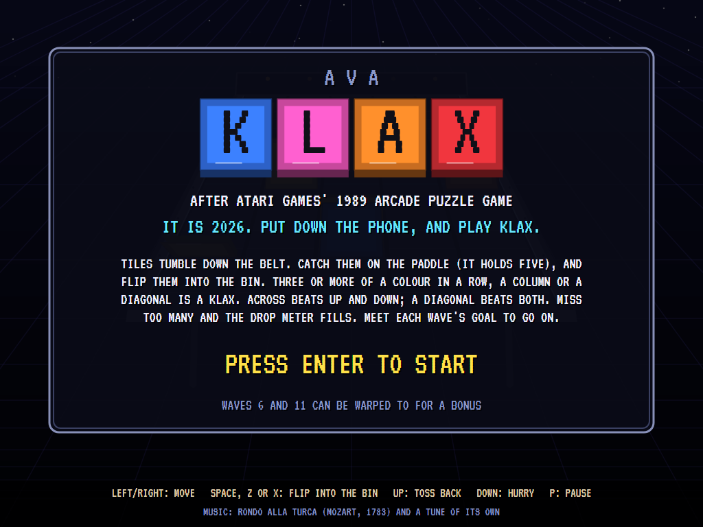
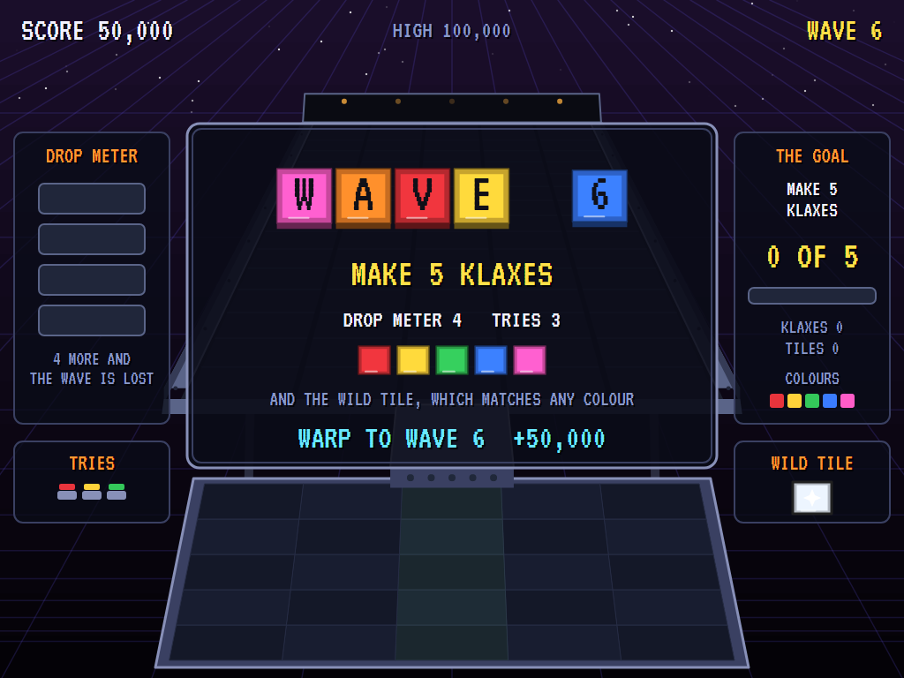
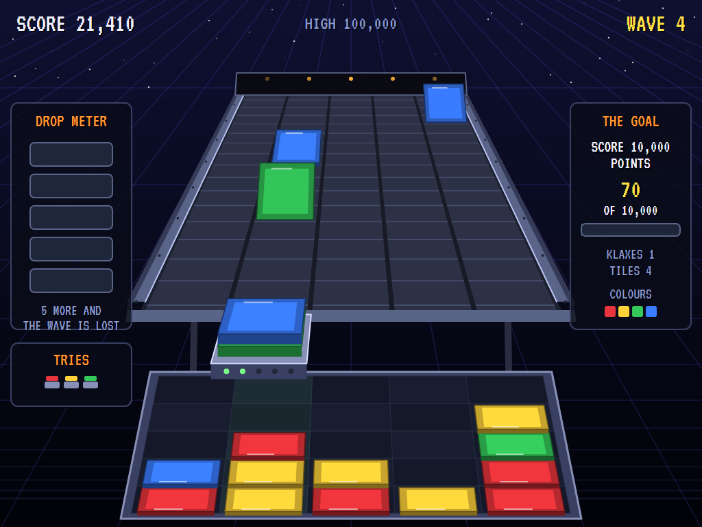
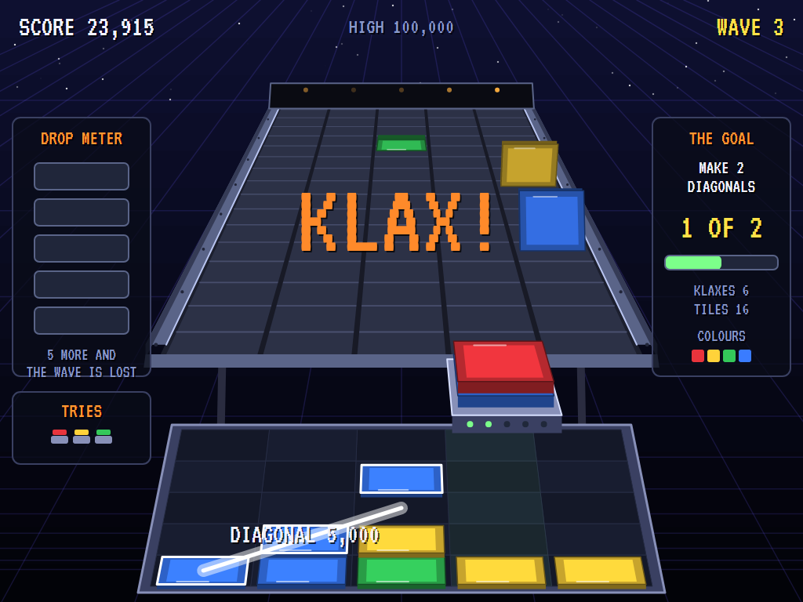
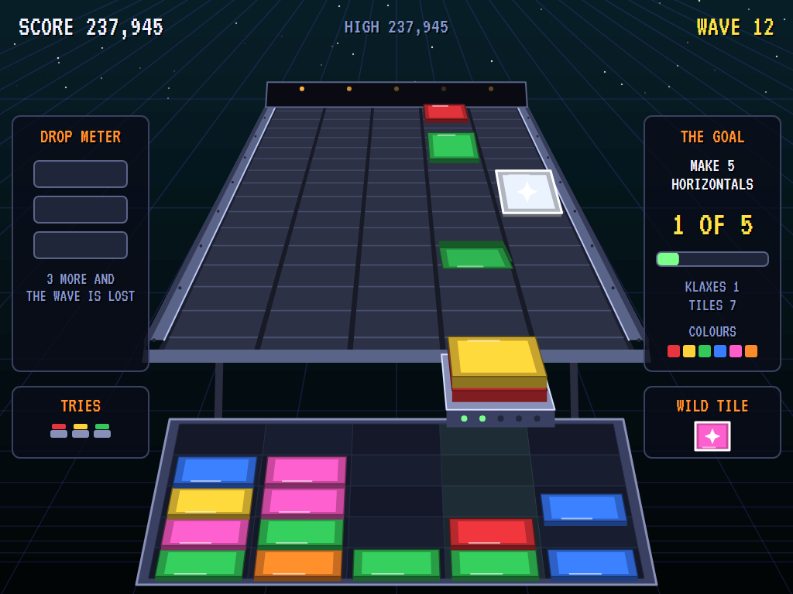
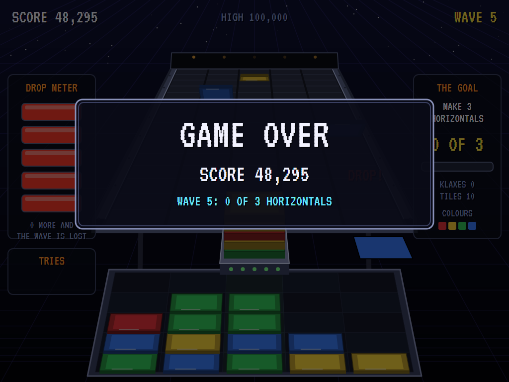
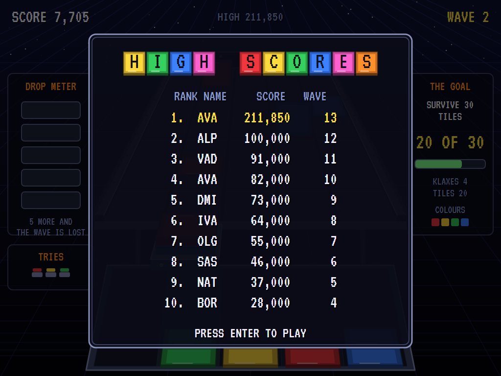

# AVA Klax

[](https://github.com/Harlock123/AVAKlax/actions/workflows/build.yml)

A puzzle game in the style of Atari Games' 1989 arcade game **Klax**, built with .NET 10 and Avalonia UI. Coloured
tiles tumble end over end down a five-lane conveyor belt toward you. Catch them on your paddle, which holds a stack
of five, and flip them into the bin below. Three or more of a colour in a row, a column or a diagonal is a Klax, and
it's gone. Miss too many tiles and the drop meter fills. Meet each wave's goal to go on to the next. It is 2026: put
down the phone, and play Klax.

## Features

- **The belt:** five lanes, seen in perspective, the far end small and the near end wide. Every tile turns over
  about its near edge, its far edge coming up and over, and lands flat a tile length nearer, then the next.
- **The paddle** moves a lane at a tap and keeps going when held. A tile that tips off the end of its lane lands on
  the paddle if it's there with room, on top of the stack. Five is the most it holds; a sixth falls past.
- **Flip** the top tile into the bin, a five-by-five well under the paddle: it drops to the bottom of the column, or
  onto the tiles there. **Toss** it back up the belt instead and it tumbles back up, turns round when it reaches the
  top (or comes up behind another tile) and comes down again. **Hurry** the belt and every tile comes three times as
  fast.
- **Klaxes:** three, four or five of a colour in a line. Across beats up and down, a diagonal beats both, and longer
  beats shorter: 50, 500 and 1,500 up and down; 1,000, 5,000 and 10,000 across; 5,000, 10,000 and 20,000 diagonally.
  The Klax flashes, the voice says so, and the tiles above it fall into the gap.
- **Combinations and chains:** Klaxes made at once are each worth as many times their points as there are of them.
  A Klax made by tiles falling into the gap is a chain, worth twice, then three times, and so on.
- **The drop meter:** every tile missed lights a lamp. Fill it and the wave is lost; it starts again with an empty
  bin, as long as there's a try left. Three tries.
- **Wave goals,** on a card before each wave: make three Klaxes, survive 30 tiles, make two diagonals, score 10,000
  points, make three horizontals, make a Klax of four or five, and so on: fifteen waves of goals, then round again
  asking half as much more each time. Meet the goal, and every empty square left in the bin is worth 250.
- **Harder every wave:** the belt runs quicker and the tiles come closer together. Four colours at first, five from
  wave 6, six from wave 11, seven from wave 16. The drop meter is five lamps for waves 1 to 5, four for 6 to 10, then
  three. From wave 6 the **wild tile** comes now and then, flashing through every colour: it matches any of them.
- **Warps:** a new game starts with the wave select. Start at wave 1, or warp to wave 6 for 50,000 or wave 11 for
  150,000.
- **The attract mode** shows the computer player at work. It tries the tile on top of its paddle in every column of
  a copy of the bin: a Klax is best (and one the wave's goal wants, better still), else a place lining it up with
  tiles of its colour in lines that could still be finished, low down. It takes the tile there if that's worth doing
  and there's time before the next tile tips off the belt, and otherwise goes to catch it.

## Screenshots

| The title | The wave card | In play |
|:---------:|:-------------:|:-------:|
|  |  |  |
| | Warped to wave 6. | Wave 4, the bin filling up. |

| A Klax | Wave 12 | Game over |
|:------:|:-------:|:---------:|
|  |  |  |
| A diagonal: 5,000. | Six colours, and the wild tile. | |

| The high scores |
|:---------------:|
|  |

The screenshots are made by the tests, which play the game in a real (headless) window; see
[Tests](#tests).

## Download and run

Ready-to-run builds for Windows, macOS and Linux, on both Intel/AMD and ARM, are on the
[Releases page](https://github.com/Harlock123/AVAKlax/releases/tag/latest). **Latest build** is
rebuilt on every push to `main`. Each download is one self-contained executable: no .NET install is
needed.

| Platform | Archive |
|---|---|
| Windows | `AVAKlax-win-x64.zip`, `AVAKlax-win-x86.zip`, `AVAKlax-win-arm64.zip` |
| macOS | `AVAKlax-osx-arm64.tar.gz` (Apple silicon), `AVAKlax-osx-x64.tar.gz` (Intel) |
| Linux | `AVAKlax-linux-x64.tar.gz`, `AVAKlax-linux-arm64.tar.gz`, `AVAKlax-linux-arm.tar.gz` |

```bash
tar -xzf AVAKlax-linux-x64.tar.gz     # or linux-arm64, linux-arm, osx-arm64, osx-x64
./AVAKlax
```

On Windows, unzip and run `AVAKlax.exe`. On macOS, if Gatekeeper refuses to open it, run
`xattr -d com.apple.quarantine AVAKlax` once. Run with `--no-audio` for silence.

**Sound** comes through OpenAL Soft, built in for every platform. In a virtual machine the game
detects it and uses a larger audio buffer, so the sound doesn't break up.

**Gamepads** use SDL2, which is bundled for Windows, macOS and Intel/AMD Linux. ARM Linux builds need it
installed; without it the keyboard still works:

```bash
sudo apt install libsdl2-dev            # Debian / Ubuntu / Raspberry Pi OS
sudo pacman -S --needed sdl2-compat     # Arch / Omarchy
```

## Controls

| Action | Keyboard | Gamepad |
|---|---|---|
| Start | Enter or 1 | Start |
| Move the paddle | Left and right, or A and D. A tap moves a lane; held, it keeps going | Left stick / D-pad |
| Flip the top tile into the bin | Space, Z, X or Ctrl | A or B |
| Toss the top tile back up the belt | Up or W | Stick or D-pad up, or Y |
| Hurry the belt | Down or S (held) | Stick or D-pad down |
| Choose a wave (at the start) | Left and right, then Space or Enter | Stick, then A |
| Pause | P or Esc | Start |
| Sound on/off | M | |
| Screenshot | Ctrl+S (to your Pictures folder) | |

On the high-score table, type your initials, or use up/down and Space, then Enter.

## Tests

```bash
dotnet test AVAKlax.slnx
```

The game runs in fixed 60 Hz steps, so it plays the same at any frame rate. Everything that changes lives in
one world that can be copied. The tests check:

- **The belt and the paddle:** a tile tumbling down its lane a flip at a time and landing on the paddle; the
  paddle a lane a tap, on while held, stopping at the sides and turning back between lanes; a drop, and a full drop
  meter losing the wave; a stack of five and a sixth tile falling past; the up key tossing a tile back up the belt
  and it coming down again; a tossed tile turning round behind one coming down; the down key hurrying the belt.
- **The bin:** a flip to the bottom of the column or onto the tiles there, one flip a press, and a full column
  taking no more; the twenty lines of three or more; a Klax across, up and down, and along both diagonals, of three,
  four and five, with their points; the wild tile matching any colour; combinations; tiles falling into the gap and
  a chain; nothing going in while a Klax flashes.
- **The waves:** each goal counting its own kind of Klax (or tiles, or points), and the wave ending once the Klax
  has gone; quicker belts, more colours, the wild tile and shorter drop meters later on; the paddle standing still
  losing the wave; a copied world going on as the original.
- **The computer player** meeting the goals of waves 1 to 10 without a drop, and of waves 11 to 15.
- **The game:** the wave select and a warp's bonus; a wave done paying for its empty squares; a full drop meter
  costing a try, then the end and a high score; the demonstration and high scores; every sound's file; the keys,
  through the same input handler the game uses.

`tests/AVAKlax.Tests/PilotProbe.cs` reports how the computer player gets on, for tuning (`KLAX_PROBE=1`, with
`KLAX_FROM` and `KLAX_WAVES` to choose the waves). It meets the goals of the first nineteen waves without a drop,
and 25 of the first 30. `KLAX_PROBE=lazy` stands under the next tile and flips everything straight in; that gets it
through the first four waves, then the bin fills and it loses wave 5.

The screenshot tests draw the real screen in a headless window. To refresh the README's pictures:

```bash
KLAX_SHOTS=$PWD/Images dotnet test tests/AVAKlax.Tests --filter ScreenshotTests
```

## Building

```bash
dotnet build AVAKlax.slnx
dotnet run --project src/AVAKlax
```

Needs the .NET 10 SDK. The sounds, music and voices are made by `tools/make_sounds.py` (standard-library
Python, with the formant voice in `tools/speech.py`): `python3 tools/make_sounds.py` rewrites
`src/AVAKlax/Sounds`.

## Project structure

```
AVAKlax/
├── AVAKlax.slnx
├── src/AVAKlax/
│   ├── Engine/
│   │   ├── GameEngine.cs        # States, the wave select, wave cards, tries, the demonstration
│   │   ├── Sim.cs               # The belt, the paddle, flips and tosses, finding Klaxes, combinations and chains, the waves
│   │   ├── World.cs             # Tiles, the bin, goals, and everything that changes, kept so it can be copied
│   │   ├── Pilot.cs             # The computer player (the demonstration, and the tests)
│   │   ├── HighScoreTable.cs, InitialsEntry.cs
│   │   ├── InputHandler.cs, ControllerManager.cs  # Keys and an SDL2 gamepad
│   │   └── SoundManager.cs      # Effects, music and voices through OpenAL
│   ├── Audio/                   # The OpenAL engine (from the author's AVABand)
│   ├── Views/GameCanvas*.cs     # The belt in perspective, the tumbling tiles, the paddle, the bin, the screens
│   └── Sounds/                  # The synthesised effects, music and voices
├── tests/AVAKlax.Tests/         # Gameplay and screenshot tests
├── tools/make_sounds.py, tools/speech.py
└── Images/                      # Screenshots
```

## About and licence

AVA Klax © 2026 Lonnie Watson, under the [MIT License](LICENSE).

*Klax* © 1989 Atari Games; the name *Klax* belongs to its current owner. AVA Klax is an independent, unofficial
game in its style. Its graphics, sounds, voices and code are its own; nothing is taken from the original game's
program, graphics or sound. It is not affiliated with or endorsed by any rights holder. The title music is the
*Rondo alla Turca* from Wolfgang Amadeus Mozart's Piano Sonata No. 11 in A major, K. 331 (1783); the tune in play is
the game's own.
